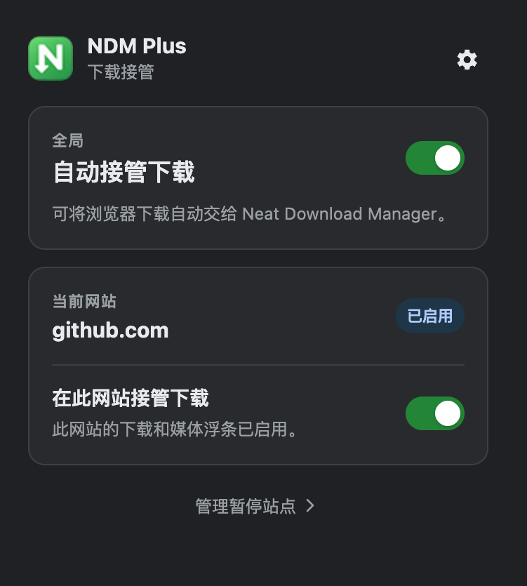
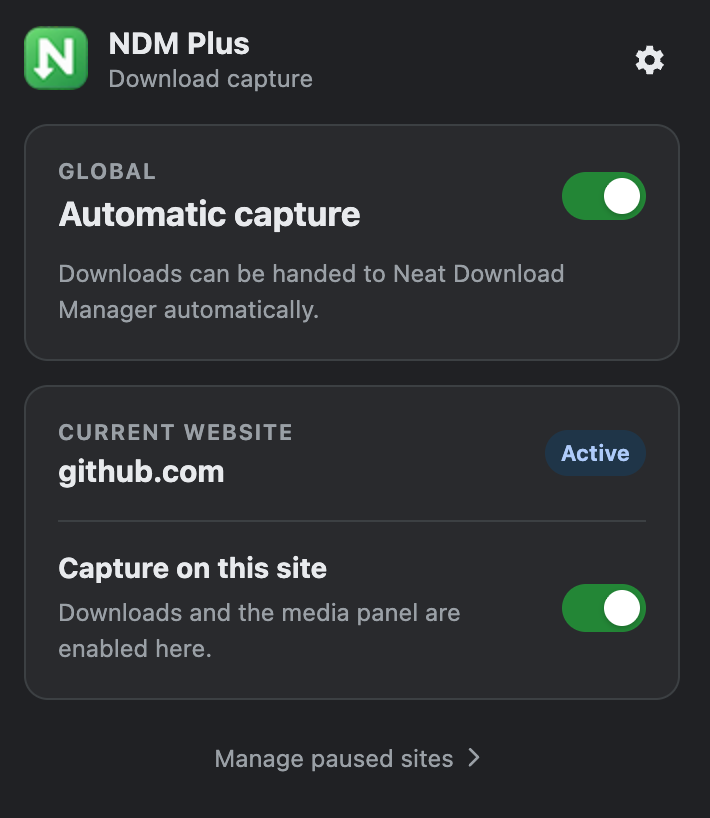
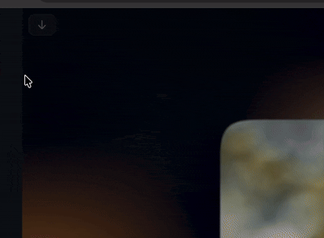
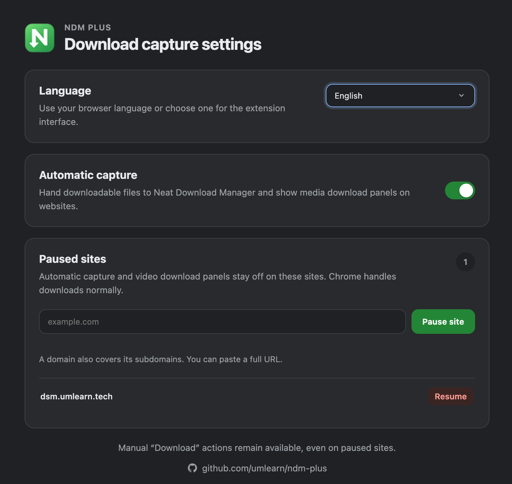

<p align="center">
  
</p>

<p align="center">
  <a href="README.md">简体中文</a> · <strong>English</strong>
</p>

<p align="center">
  <a href="#interface-preview">Preview</a> ·
  <a href="#-features">Features</a> ·
  <a href="#-installation">Installation</a> ·
  <a href="#-usage">Usage</a> ·
  <a href="#-development">Development</a>
</p>

<p align="center">
  
  
  <a href="https://github.com/umlearn/ndm-plus/releases/latest">
    
  </a>
  
</p>

## NDM Plus

NDM Plus is an unofficial Chromium browser extension for **Neat Download Manager** users. It detects regular downloads and media resources while you browse, hands their links to the local Neat Download Manager app, and provides a lightweight download control next to videos.

Compared with the original extension, NDM Plus adds global pause controls, a per-site toggle, and paused-domain management. On sites where automatic capture is not needed, downloads can stay in the browser while the manual **Download** context-menu action remains available.

The extension is built with **Manifest V3, vanilla JavaScript, HTML, and CSS**. Its interface supports Simplified Chinese and English, and it does not require a build step or third-party runtime. NDM Plus is not a download manager itself; [Neat Download Manager](https://www.neatdownloadmanager.com/) must be installed and running on your computer.

> NDM Plus is an independently maintained community edition and is not affiliated with the official Neat Download Manager project.

## Interface preview

<p align="center">
  
  
</p>

<p align="center">
  <sub>The toolbar panel provides global capture and current-site switches, with quick access to paused-site management.</sub>
</p>

### Video download control

After a video loads, NDM Plus shows a low-profile download button in the upper-left corner of the player. Hover over or focus the button to expand the detected media resources and choose which version to send to NDM.

<p align="center">
  
</p>

## ✨ Features

- Detects regular files, images, audio, video, and HLS playlists on web pages and sends them to Neat Download Manager
- Shows a low-profile download control in the upper-left corner of videos, expanding on hover or keyboard focus
- Supports a global pause for automatic capture; Chrome then handles downloads normally and video controls stay hidden
- Provides a current-site toggle without opening the settings page
- Manages paused domains from one place, with each rule covering its subdomains
- Keeps discovered media cached while paused, so capture can resume without reloading the page
- Follows the browser language by default and supports manual selection of Chinese or English
- Provides an independent translation registry for adding more interface languages
- Sends links manually to NDM through the **Download** context-menu action
- Bypasses automatic capture for a single link when clicking it while holding `Ctrl`, `Alt`, `Shift`, or `⌘`
- Improves detection of HLS, TS, and small complete videos, preferring meaningful page or video titles
- Handles page scrolling, dynamic players, `<source>`, `currentSrc`, and open Shadow DOM content
- Applies settings and site-pause changes immediately and persists them locally in the browser

NDM Plus does not process DRM-protected media, and it cannot guarantee detection of every URL generated dynamically by JavaScript or protected by special authentication or proprietary segmented protocols.

## 🚀 Installation

### Download a release

Download the latest `NDM-Plus-<version>.zip` from [GitHub Releases](https://github.com/umlearn/ndm-plus/releases/latest).

1. Extract the ZIP and place the extension folder somewhere permanent.
2. Open `chrome://extensions` in Chrome or a Chromium-based browser.
3. Enable **Developer mode** in the upper-right corner.
4. Click **Load unpacked** and select the extracted folder.
5. Install and start Neat Download Manager, then make sure its local service is running.

Do not delete the extension folder, or the browser will not be able to load it on the next launch. To update, download the new release, extract it, and replace the previous folder.

### Install from source

```sh
git clone https://github.com/umlearn/ndm-plus.git
cd ndm-plus
```

Then open `chrome://extensions`, choose **Load unpacked**, and select the repository root. The repository has no build step.

Firefox users can try the community project [iiHawe/NeatDownloadManager-Extension](https://github.com/iiHawe/NeatDownloadManager-Extension); it is not part of this project.

## 🕹 Usage

1. Click the NDM Plus icon in the browser toolbar.
2. Use **Automatic capture** to enable or pause global capture.
3. Use **Capture on this site** to pause capture for the current site only.
4. Click **Manage paused sites** to add or remove domains that should remain paused.
5. In the settings page, use **Language** to follow the browser automatically or manually select Chinese or English.

Pausing only affects automatic capture; it does not disable the manual download action in the context menu. The video control starts at low opacity and reveals the complete resource list on hover or keyboard focus. Click `×` to hide the current control until the page is refreshed.

See [LOCALIZATION.md](./LOCALIZATION.md) for instructions on adding interface languages.

If Neat Download Manager does not respond, first confirm that the desktop app is running. To bypass a single link temporarily, hold `Ctrl`, `Alt`, `Shift`, or `⌘` while clicking it.

<p align="center">
  <a href="docs/img/settings.png">
    
  </a>
</p>

<p align="center">
  <sub>Manage the interface language, global capture, and paused websites from one page. Domain rules also cover subdomains.</sub>
</p>

## 🔐 Permissions and privacy

To detect downloads and media requests across websites, the extension needs access to page content, request headers, cookies, and download events. This information is used to hand download details to the local Neat Download Manager app. The extension has no account system, telemetry, or cloud synchronization.

The extension only connects to NDM's local WebSocket service. If automatic capture is not needed, pause all capture from the toolbar or settings page.

## 🧑‍💻 Development

The project is maintained as a native browser extension with no package manager or build step. Main files:

- `bg.js`: service worker, download-request detection, NDM communication, and HLS handling
- `ct.js`: in-page media controls, player association, and interaction
- `capture-policy.js`: global and per-site pause rules
- `i18n.js`: browser language detection, manual language selection, and translation registration
- `media.js`: media classification and HLS manifest parsing
- `popup.*`: toolbar status panel
- `options.*`: automatic-capture and paused-site settings page
- `tests/`: unit tests using the native Node.js test runner

Run the tests:

```sh
node --test tests/*.test.js
```

The tests cover pause policy, download detection, HLS parsing, media-control positioning, duplicate-resource handling, BFCache lifecycle, modifier-key bypass, and language fallback.

## Requirements

- Chrome or another Chromium browser with Manifest V3 support
- The Neat Download Manager desktop app
- Browser Developer mode for installing an unpacked release
- Node.js for running the tests

## Notes

- Neat Download Manager does not provide a built-in switch for blocking automatic downloads per site, so NDM Plus adds fine-grained pause controls
- A page may need to be refreshed after updating the extension
- Download URLs are controlled by third-party websites, so expired links, authentication changes, or server-side restrictions can still prevent a download
- This project does not provide the Neat Download Manager desktop app

## Acknowledgements

Thanks to the authors of the original Neat Download Manager extension, [yizhimuzhuozi](https://github.com/yizhimuzhuozi), [Leenshady](https://github.com/Leenshady), and everyone who has contributed code or reported issues. Upstream attribution and contributor history remain in the Git commit history.
