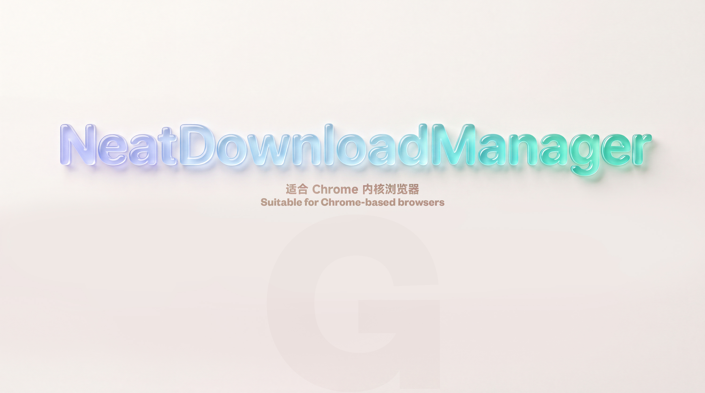

<h1 align="center">NDM Plus</h1>

  

  

**NDM Plus** 是 Neat Download Manager 的**非官方社区增强扩展**，由社区独立维护，与 Neat Download Manager 官方无隶属关系。

NDM Plus 在原有扩展能力上增加了全局暂停、按网站暂停、视频资源嗅探与更简洁的下载面板，减少不需要自动接管的网站反复弹出下载框。上游来源和贡献者记录保留在 Git 提交历史中。

<h3 align="center">之前 Before</h3>

  

<h3 align="center">之后 After</h3>

  

## Firefox 火狐浏览器
如果你是 Firefox 用户你可以使用这个项目 [iiHawe](https://github.com/iiHawe/NeatDownloadManager-Extension)

## Chrome 安装

1. 下载并解压扩展(点击本页面右上角绿色的 **Code** 按钮，然后选择 **Download ZIP**。)
2. 打开 Chrome 扩展程序
3. 开启右上角的 "开发者模式"
4. 把解压后的 `ndm-plus-main` 文件夹拖到 Chrome 扩展程序中

注意：解压后的扩展文件夹不能删除，否则无法使用，可以存放到固定位置

## 使用方法

点击工具栏中的扩展图标可以打开设置面板：

- **Automatic capture**：全局开启或暂停自动接管下载。暂停后，Chrome 下载会保持原样，视频下载浮条也会隐藏。
- **Capture on this site**：只为当前网站暂停或恢复自动接管。
- **Manage paused sites**：集中添加和移除暂停域名。一个域名同时覆盖它的子域名。

全局和网站开关会即时生效，不需要刷新页面。暂停前已发现的媒体会保留在当前页面的候选缓存中，重新启用后可以直接恢复。

仍然可以在目标网站右键点击 **Download** 手动把链接发送给 Neat Download Manager；暂停网站不会影响这个手动入口。

## 更新日志

2025-12-30

- 修改屏蔽网站逻辑
- 之前很多网站的下载链接都是通过 js 动态生成的，现在可以正常工作
- 缩短了菜单文本：
  - "Download by NeatDownloadManager"改成"Download"
  - "Block downloads from this website"改成"Block downloads"
  - "Unblock downloads from this website"改成"Unblock downloads"

2026-02-02

- 添加图片展示

2026-02-06

- 添加安装说明

2026-3-16  均有 [Leenshady](https://github.com/Leenshady) 提供帮助

- 修复被屏蔽的网站所有下载链接会被拦截问题，现在被屏蔽的网址所有的下载链接都会绕过NDM且被放行
- 增加临时绕过NDM下载功能，按住Ctrl键点击下载链接可以绕过NDM进行下载

2026-07-05 均有 [Leenshady](https://github.com/Leenshady) 提供帮助

1. 优化绕过NDM下载的逻辑，提高成功率；
2. 修复某些情况下blockhosts失效、关闭扩展失效的问题；
3. 修复上下文菜单块下载和ublock下载名称更新不及时问题；
4. 增加绕过下载的热键，现在按住ctrl、alt、Windows/Command、shift键点击下载链接绕过NDM进行下载。

2026-07-09

* 修改 README.md

2026-10-16

- 视频下载浮条改为简约深色圆角样式，默认低透明度；鼠标悬停或键盘聚焦时完全显示并展开下载列表。
- 浮条跟随视频位置，支持页面及嵌套容器滚动；锚点滚出可视范围时隐藏，避免停留在页面边缘。
- 点击 × 可隐藏当前浮条；新发现的资源不会重新打开已关闭的浮条，刷新页面后恢复。

- 浮条仅保留下载图标，显示在视频左上角内侧，距顶部及左边缘 8px；保留低透明度及悬停展开效果。
- 定位更新改为滚动、尺寸及 DOM 变化触发，同一帧合并处理；可见视频每 500ms 补充位置检查，关闭、离屏及后台页面暂停持续位置检查。

2026-10-17

- 优化媒体嗅探：识别 HLS 清单及音轨，保留小体积完整视频。
- 改进播放器关联及下载浮条定位，支持 `<source>`、`currentSrc` 和开放的 Shadow DOM。
- HLS/TS 优先按视频或页面标题命名；修复请求时序及快捷键绕过范围，并保留 NDM 原下载流程。

2026-10-24

- 项目以 **NDM Plus** 名称独立维护，并明确标注为非官方社区版本。
- 工具栏改为状态面板，提供全局自动接管开关和当前网站开关。
- 统一全局暂停与网站暂停状态：两者都会停止自动发送下载并隐藏视频浮条。
- 全局开关持久化保存；新增暂停站点管理页面，并兼容原有屏蔽域名数据。
- 暂停期间保留当前页面的媒体候选缓存，重新启用时无需刷新即可恢复。
- 同一媒体资源只绑定一个浮条；媒体尚未识别时会从页面级浮条迁移到视频位置，避免恢复或刷新后出现重复浮条。

 

### 🎬 THE END

