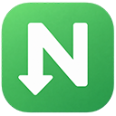
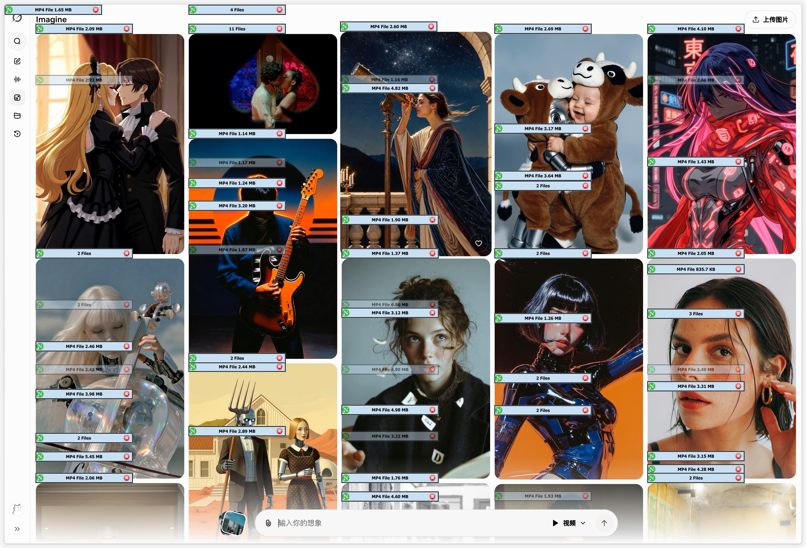

<p align="center">
  
</p>

<p align="center">
  <strong>简体中文</strong> ·
  <a href="#功能">功能</a> ·
  <a href="#安装">安装</a> ·
  <a href="#使用">使用</a> ·
  <a href="#开发">开发</a>
</p>

<p align="center">
  
  
  <a href="https://github.com/umlearn/ndm-plus/releases/latest">
    
  </a>
  
</p>

## NDM Plus

NDM Plus 是一款面向 **Neat Download Manager** 用户的非官方 Chromium 浏览器扩展。它会在浏览网页时识别普通下载和媒体资源，把链接交给本机的 Neat Download Manager，并在视频附近提供一个轻量的下载浮条。

相比原扩展，NDM Plus 增加了全局暂停、当前网站暂停和暂停域名管理。对于不需要自动接管的网站，可以让下载重新交给浏览器处理，同时保留右键手动发送到 NDM 的入口。

扩展使用 **Manifest V3、原生 JavaScript、HTML 与 CSS** 构建，无需编译或安装第三方运行时。NDM Plus 不是下载器本身，使用前需要在电脑上安装并运行 [Neat Download Manager](https://www.neatdownloadmanager.com/)。

> NDM Plus 是独立维护的社区版本，与 Neat Download Manager 官方无隶属关系。

## 前后对比

<p align="center">
  
  
</p>

<p align="center">
  <sub>左侧：未暂停网站时，页面中的媒体可能显示多个下载浮条；右侧：暂停不需要接管的网站后，页面保持干净。</sub>
</p>

## ✨ 功能

- 自动识别网页中的普通文件、图片、音视频和 HLS 播放列表，并发送到 Neat Download Manager
- 在视频左上角显示低干扰下载浮条，悬停或键盘聚焦时展开可选资源
- 支持全局暂停自动接管，暂停后 Chrome 下载保持原样，视频浮条也会隐藏
- 支持当前网站快捷暂停，无需打开设置页
- 支持集中管理暂停域名，一条规则同时覆盖它的子域名
- 暂停期间继续缓存已发现的媒体，恢复后无需刷新页面
- 支持通过右键菜单 **Download** 手动把链接发送到 NDM
- 支持按住 `Ctrl`、`Alt`、`Shift` 或 `⌘` 点击链接，对单次下载绕过自动接管
- 优化 HLS、TS 和小体积完整视频的识别，并优先使用有意义的页面或视频标题
- 适配页面滚动、动态播放器、`<source>`、`currentSrc` 和开放的 Shadow DOM
- 设置和网站暂停状态即时生效，并持久化保存在浏览器本地

不会处理受 DRM 保护的媒体，也不保证识别所有由 JavaScript 动态生成、需要特殊认证或使用专有分段协议的下载地址。

## 🚀 安装

### 下载预构建版本

从 [GitHub Releases](https://github.com/umlearn/ndm-plus/releases/latest) 下载最新的 `NDM-Plus-<version>.zip`。

1. 解压 ZIP，并把扩展文件夹放到一个长期保留的位置。
2. 在 Chrome 或 Chromium 浏览器中打开 `chrome://extensions`。
3. 开启页面右上角的 **开发者模式**。
4. 点击 **加载已解压的扩展程序**，选择解压后的文件夹。
5. 安装并启动 Neat Download Manager，确认其本地服务正常运行。

请不要删除扩展文件夹，否则浏览器会在下次启动时无法加载扩展。更新时重新下载 Release、解压并替换旧文件夹即可。

### 从源码安装

```sh
git clone https://github.com/umlearn/ndm-plus.git
cd ndm-plus
```

随后在 `chrome://extensions` 中选择 **加载已解压的扩展程序**，并选中仓库根目录。仓库不需要构建步骤。

Firefox 用户可以使用社区中的 [iiHawe/NeatDownloadManager-Extension](https://github.com/iiHawe/NeatDownloadManager-Extension)；它不属于本项目。

## 🕹 使用

1. 点击浏览器工具栏中的 NDM Plus 图标。
2. 使用 **Automatic capture** 开启或暂停全局自动接管。
3. 使用 **Capture on this site** 单独暂停当前网站。
4. 点击 **Manage paused sites**，添加或移除需要长期暂停的域名。

暂停只影响自动接管，不会禁用右键菜单中的手动下载入口。视频浮条首次出现时保持低透明度，鼠标悬停或键盘聚焦后显示完整资源列表；点击 `×` 可以隐藏当前浮条，刷新页面后恢复。

如果 Neat Download Manager 没有响应，请先确认桌面应用正在运行。临时绕过某个链接时，可以按住 `Ctrl`、`Alt`、`Shift` 或 `⌘` 再点击它。

## 🔐 权限与隐私

为了在所有网站上识别下载和媒体请求，扩展需要访问网页内容、请求头、Cookie 和下载事件。这些数据用于把下载信息交给本机的 Neat Download Manager，不包含独立账户、遥测或云同步功能。

扩展仅连接本机 NDM 的 WebSocket 服务；如果不需要自动接管，可以在工具栏或设置页暂停全部捕获。

## 🧑‍💻 开发

项目以原生浏览器扩展形式维护，没有包管理器或打包步骤。主要文件：

- `bg.js`：Service Worker、下载请求识别、NDM 通信和 HLS 处理
- `ct.js`：网页内的媒体面板、播放器关联和交互
- `capture-policy.js`：全局与网站暂停规则
- `media.js`：媒体分类和 HLS 清单解析
- `popup.*`：工具栏状态面板
- `options.*`：自动接管与暂停站点设置页
- `tests/`：基于 Node.js 原生测试运行器的单元测试

运行测试：

```sh
node --test tests/*.test.js
```

测试覆盖暂停策略、下载识别、HLS 解析、媒体面板定位、BFCache 生命周期和快捷键绕过等核心逻辑。

## 系统要求

- Chrome 或其他支持 Manifest V3 的 Chromium 浏览器
- Neat Download Manager 桌面应用
- 安装预构建版本时需要开启浏览器开发者模式
- 运行测试需要 Node.js

## 说明

- Neat Download Manager 官方未提供屏蔽单个网站自动下载的内置开关，NDM Plus 因此增加了细粒度的暂停控制
- 浏览器扩展更新后，已打开的页面可能需要刷新一次
- 下载地址由第三方网站控制，资源失效、鉴权变化或服务端限制仍可能导致下载失败
- 本项目不提供 Neat Download Manager 桌面应用

## 致谢

感谢 Neat Download Manager 原扩展作者，以及 [yizhimuzhuozi](https://github.com/yizhimuzhuozi)、[Leenshady](https://github.com/Leenshady) 和所有提交代码、反馈问题的贡献者。上游来源和贡献记录保留在 Git 提交历史中。

## 许可证

当前仓库尚未提供独立许可证文件。项目包含来自上游 NeatDownloadManager Extension 的代码和资源；在明确再分发与修改授权前，请不要把本项目视为已经采用开源许可证。
